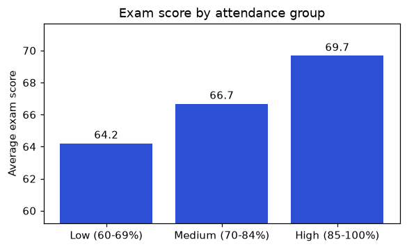
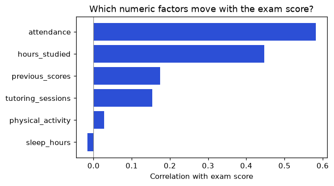
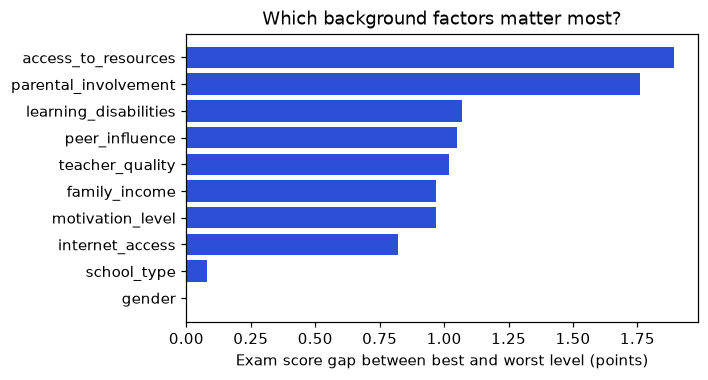
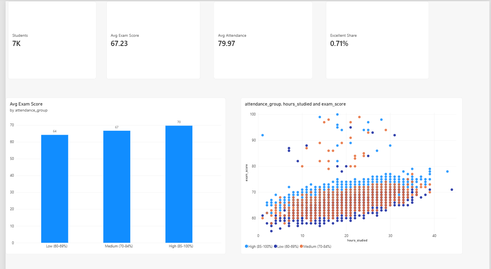
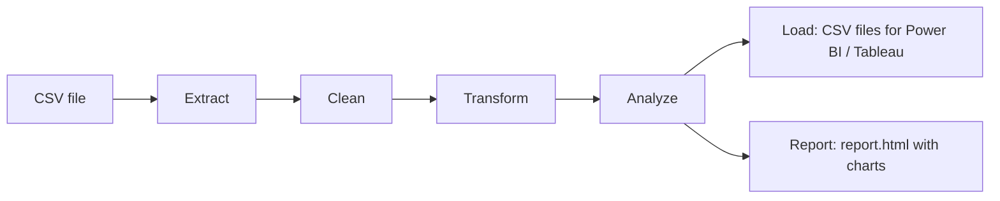

# Student Performance Analytics Pipeline

An automated Python pipeline that takes raw student data and turns it into clean data, analysis tables and an HTML report. It is built in six steps: **Extract → Clean → Transform → Analyze → Load → Report**.



## Key findings
Based on 6,606 students from the Kaggle dataset [Student Performance Factors](https://www.kaggle.com/datasets/lainguyn123/student-performance-factors) (CC0: Public Domain).

- **Attendance is the strongest factor.** It has the highest correlation with the exam score (r = 0.58). Students with 85–100% attendance average 69.7, against 64.2 for students with 60–69%.
- **Study hours come second** (r = 0.45). Sleep hours show almost no link.
- **Background factors matter little.** The largest gap is access to resources at 1.9 points; gender shows no difference.
- **An anomaly worth noting:** only 47 students score 80 or more. They sit far above the main group and study fewer hours (19.3 a week) than "Good" students (21.1), so they look like unusual cases rather than a trend.

Correlation shows association, not cause.

| Numeric factors | Background factors |
|---|---|
|  |  |

## Power BI dashboard
The cleaned data (`output/student_performance_clean.csv`) feeds an interactive Power BI dashboard (`dashboard.pbix`): KPI cards for students, average exam score, average attendance and the share of excellent students, a bar chart of exam score by attendance group, and a scatter chart of hours studied against exam score coloured by attendance group.



DAX measures used:
```
Students          = COUNTROWS(student_performance_clean)
Avg Exam Score    = AVERAGE(student_performance_clean[exam_score])
Avg Attendance    = AVERAGE(student_performance_clean[attendance])
Avg Hours Studied = AVERAGE(student_performance_clean[hours_studied])
Excellent Share   = DIVIDE(
                      CALCULATE([Students], student_performance_clean[performance_level] = "Excellent"),
                      [Students])
```
Re-running the pipeline and pressing **Refresh** in Power BI updates the dashboard.

## How it works


| Step | What it does |
|---|---|
| **Extract** | Reads the CSV and converts column names to snake_case |
| **Clean** | Removes duplicates · strips text such as "hours", "%" and "/100" and converts it to numbers · marks out-of-range values (e.g. an exam score of 101) as missing · drops rows without an exam score · fills other gaps (median for numbers, "Unknown" for text) · records everything in a cleaning log |
| **Transform** | Adds `performance_level` (Needs Improvement < 65, Good 65–79, Excellent 80–100), `attendance_group` and `score_change` |
| **Analyze** | Average score by attendance group (`groupby`), summary per performance level (`agg`), correlations (`corr`), and score gaps per background factor |
| **Load** | Writes 5 CSV files to `output/`, ready for Power BI or Tableau |
| **Report** | Writes `output/report.html` with key figures, findings, charts and the data-quality log |

`run_pipeline()` runs all six steps in order. `airflow_dag.py` schedules it daily with Apache Airflow.

### Robustness test
The source dataset is fairly clean, so `make_messy_data.py` generates a synthetic messy version (60 duplicates, numbers stored as text, 28 out-of-range values, extra missing values). The cleaning step handles it fully: all duplicates are removed, all text values are converted and all invalid values are caught.

## Run it
```bash
pip install -r requirements.txt
python pipeline.py
```
Robustness test on synthetic messy data:
```bash
python make_messy_data.py
python pipeline.py --input student_performance_messy.csv
```
Group boundaries and valid ranges are settings at the top of `pipeline.py`.

## Project structure
```
├── pipeline.py                     # the six pipeline steps
├── make_messy_data.py              # generates synthetic messy data for the robustness test
├── airflow_dag.py                  # daily schedule with Apache Airflow
├── StudentPerformanceFactors.csv   # source data (Kaggle, CC0)
├── images/                         # charts used in this README
├── dashboard.pbix                  # Power BI dashboard
└── output/                         # generated by the pipeline (not in git)
```

## Tech
Python · pandas · matplotlib · Apache Airflow (scheduling example) · Power BI (dashboard)
